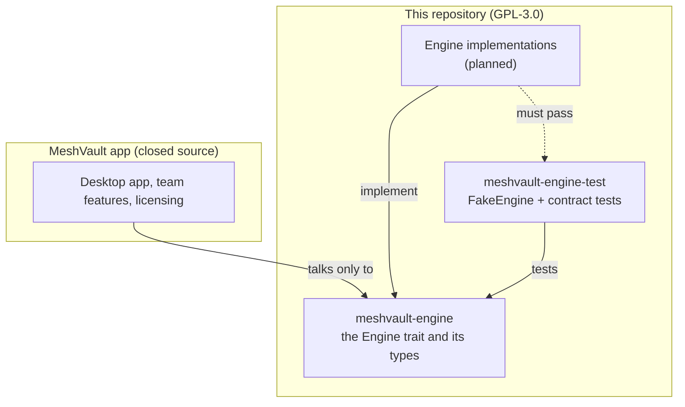

# MeshVault engine

[](https://github.com/RRI-Atharv37/meshvault/actions/workflows/ci.yml)
[](LICENSE)

MeshVault is a file-sync product for small teams that work with big files, such as video and 3D projects.
This repository is its open engine: Rust crates that move files safely between trusted devices.

Moving bytes safely between devices is open. Turning that into a team product is closed.

## Architecture



The app talks to a sync backend only through the `Engine` trait. A backend can be swapped for another
without touching the app, as long as it passes the same contract tests. Backend names, ports, keys and
raw backend errors never cross the trait.

The split exists so that the part anyone could audit and reuse, the file-moving core, is open, while the
product built around it stays closed.

Today this repository holds the open contract and its test kit. The open `meshvault-core` (chunking,
index, versions, signed updates, journal, trash) and `meshvault-net` (encrypted transport) crates come
next. The app and the sync loop that ties the open crates together are closed.

## Crates

| Crate | What it is |
|---|---|
| [`meshvault-engine`](meshvault-engine) | The `Engine` trait: peers, folders, status, events, errors, and the rules every implementation follows. |
| [`meshvault-engine-test`](meshvault-engine-test) | `FakeEngine`, an in-memory engine, and the contract tests every `Engine` must pass. |
| [`meshvault-core`](meshvault-core) | BLAKE3 hashing and FastCDC chunking (256 KiB / 1 MiB / 4 MiB), more building blocks to come. |

## Engine roadmap

- [x] `Engine` contract and `FakeEngine` with contract tests
- [x] Chunking and hashing: FastCDC and BLAKE3, with benchmarks
- [ ] Folder index and scanner over a simulated filesystem, with path safety
- [ ] Version vectors, conflict rules, signed updates, device roster and revocation
- [ ] Write-ahead journal, crash recovery, atomic apply, trash and a mass-change guard
- [ ] Encrypted transport over QUIC with resume and relay fallback
- [ ] Engine contract v2: held changes, trust updates and security alerts
- [ ] Fuzzing, fault injection, an integrity gate and a published threat model

## Chunking benchmark

`cargo run -p meshvault-core --release --example bench_folder -- <dir>` chunks and hashes every file in a
folder on one thread, reading from disk.

| Data | Size | Time | Throughput | Chunks | Average chunk |
|---|---|---|---|---|---|
| 92 video files | 73.9 GB | 124.7 s | 593 MB/s | 57,915 | 1,247 KiB |

## Testing an engine

Add the test crate as a dev-dependency, together with `tokio` (features `rt` and `macros`), then give the
macro an expression that builds a fresh engine:

```rust
meshvault_engine_test::engine_contract_tests!(MyEngine::start().await);
```

It generates one test per rule: peer add and remove, folder share, pause and resume, event order and
delivery, and idempotency.

## Building and testing

From the repository root:

```sh
cargo test
cargo clippy --all-targets -- -D warnings
cargo fmt --check
```

## Contributing and licence

Licensed GPL-3.0-only, see [LICENSE](LICENSE). Contributions need a signed CLA, see
[CONTRIBUTING.md](CONTRIBUTING.md). Changes are listed in [CHANGELOG.md](CHANGELOG.md).
